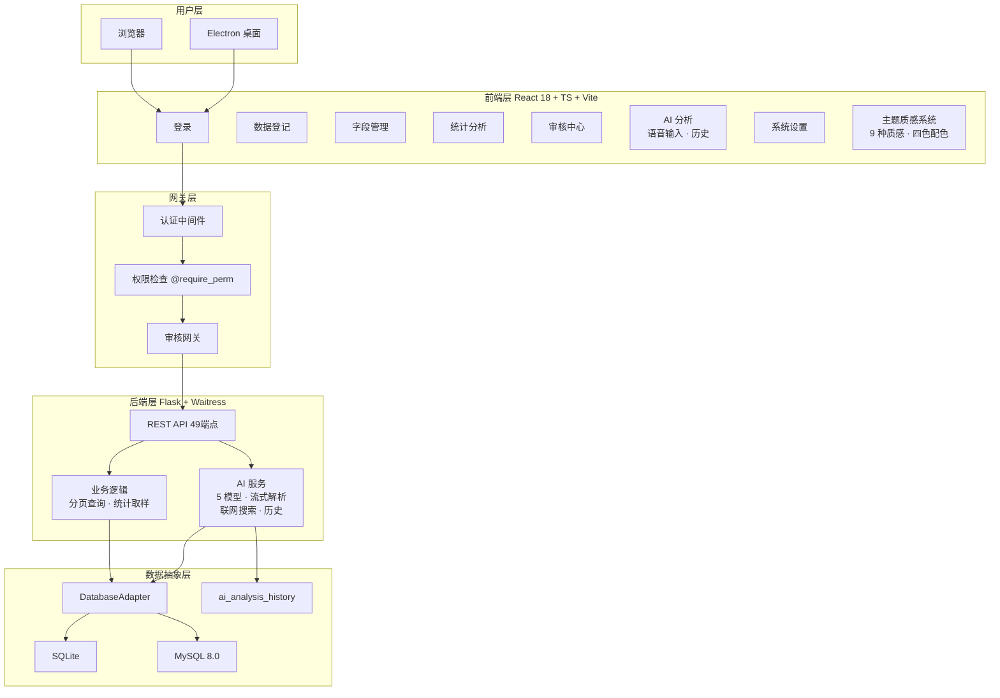

# 🚀 项目亮点 — 动态数据登记系统 v6.0

> **版本**：v6.0.0（2026-08-14）
> **迭代**：12 天 · 25 个版本 · 20 项新增 · 3 项修复 · 3 项优化
> **定位**：企业级动态数据管理平台 — 零代码字段建模 · 多模型 AI 分析 · 9 种背景质感 · 四级权限管控 · 四种部署形态

---

## 一、核心数据

| 指标 | 数值 |
|:---|:---|
| API 端点 | **49 个** |
| 前端页面 | **12 个** |
| 角色层级 | **4 级**（Boss / HR / Employee / 自定义） |
| 细粒度权限 | **21 项** |
| 动态字段类型 | **7 种** |
| 审核操作类型 | **15+ 种** |
| 背景质感 | **9 种** |
| 并发压测 | **170 并发 · 2100+ 请求 · 0% 失败率** |
| 平均响应 | **42ms** |

---

## 二、十大核心亮点

### 1. 🧩 动态字段引擎
零代码数据建模：**7 种字段类型**（文本 / 数字 / 日期 / 下拉 / 多选 / 开关 / 长文本）可视化配置，数据库自动 `ALTER TABLE` 适配表结构。元数据驱动渲染，前端根据字段配置自动生成表单与表格，**新增字段无需修改一行代码**。

### 2. 🗄️ 双数据库引擎
SQLite + MySQL 8.0 无缝切换。基于 `DatabaseAdapter` 抽象层，**一行配置切换引擎，业务代码零改动**。桌面端零配置 SQLite，生产环境 MySQL 高并发。

### 3. 🔐 三级安全网关
**认证（Session + Bearer Token）→ 权限（21 项细粒度检查）→ 审核（待审核队列）**，全链路不可绕过。PBKDF2-SHA256 密码哈希 + AES-256-GCM 数据加密。

### 4. 🤖 AI 多模型分析（v6.0 升级）
- **5 种模型预设**：OpenAI / DeepSeek / 通义千问 / 文心一言 / 自定义端点，一键切换
- **语音输入**：Web Speech API 语音转文字
- **智能联网搜索**：DeepSeek 模型支持实时联网
- **历史记录**：新建 `ai_analysis_history` 表，按用户隔离
- **按角色裁剪**：AI 看到的始终是权限范围内的数据摘要
- **错误中文化**：所有 AI 错误信息友好化

### 5. ⚡ 性能全面优化（v6.0 升级）
- **SQL 分页查询**：数据 / 审核 / 日志 / 用户列表全部分页（LIMIT/OFFSET，pageSize ≤ 100）
- **React Query 缓存**：`staleTime: 30s` + `placeholderData`，翻页零闪烁
- **4 处防抖**：搜索 500ms / 字段编辑 300ms / AI 历史 800ms / 主题配色 500ms
- **渲染优化**：`useMemo` / `useCallback` 避免无效重渲染
- **统计取样**：字段统计按取样（LIMIT 1000）计算
- **ECharts 实例复用**：按需加载

### 6. 🎨 9 种背景质感系统（v6.0 升级）
| 质感 | 说明 |
|:---|:---|
| 🪟 玻璃 Glass | 毛玻璃 + 透明叠加 |
| 🌫️ 磨砂 Frosted | 磨砂颗粒 + 柔和过渡 |
| ⚙️ 金属 Metallic | 金属拉丝高光 |
| 📄 纸张 Paper | 纸张纹理 |
| 💡 霓虹 Neon | 发光强调色 |
| 🌊 液态网格 Liquid-Mesh | 动态流动网格 |
| 🌌 深度 Depth | 渐变景深 |
| 👁️ 透明 Transparent | 极简半透明 |
| ▦ 极简平面 Flat | 纯色扁平 |

- **CSS 变量驱动**：`data-texture` + `data-theme` 双属性，150ms 平滑过渡，不再依赖 JS 注入 style
- **四色自定义配色**：强调色 / 背景色 / 卡片色 / 文本色自由搭配
- **玻璃透明度**：`--tx-glass-alpha` 可调
- **自定义背景图**：上传本地图片叠加展示
- **按用户隔离**：主题配置存入 `users.theme` 字段

### 7. ✅ 企业级审核工作流
覆盖数据新增/编辑/删除、字段增删改、用户管理、数据库重置等 **15+ 种操作**。Boss 直接执行，非 Boss 进入待审核队列，审批后自动解析执行，全程审计日志记录。

### 8. 📦 4 种部署形态
| 形态 | 场景 |
|:---|:---|
| 🖥️ Electron 桌面 | Windows / macOS / Linux，SQLite 本地库 |
| 🐳 Docker Compose | Nginx + Flask + MySQL，生产首选 |
| 📦 PyInstaller EXE | 单文件便携交付，零依赖 |
| 🌐 纯 Web | Nginx + Gunicorn，任意云服务器 |

### 9. 🛡️ 全链路数据安全
密码 **PBKDF2-SHA256** 加盐哈希 · 数据库 **AES-256-GCM** 透明加密 · **API Key 仅存内存不落盘** · 审计日志全量记录不可篡改 · 会话隔离 + Token 校验。

### 10. ⏱️ 12 天 25 版本极速迭代
**07-19** MVP → **07-20** 功能完善 → **07-21** 架构升级 → **07-22~07-27** AI 集成 & 稳定 → **07-28~08-13** UX 升级 & 个性化合规 → **08-13~08-14** v6.0 性能与质感升级。

---

## 三、技术栈一览

| 层面 | 技术 |
|:---|:---|
| 前端框架 | React 18 + TypeScript + Vite + Ant Design 5 + TailwindCSS + ECharts |
| 状态管理 | Zustand + TanStack React Query（staleTime 30s 缓存） |
| 后端框架 | Flask 3.x + Waitress（生产级 WSGI · 20 线程） |
| 数据库 | SQLite / MySQL 8.0（DatabaseAdapter 双引擎适配） |
| 主题质感 | textures.css 9 种质感 · 双属性驱动 · 四色自定义配色 |
| 桌面客户端 | Electron 28 + electron-builder（NSIS / DMG / AppImage） |
| 容器化 | Docker + docker-compose + GitHub Actions 自动构建 |
| AI 模型 | DeepSeek · OpenAI · 通义千问 · 文心一言 · 自定义端点 |
| 安全加密 | PBKDF2-SHA256 · AES-256-GCM · API Key 内存隔离 |
| 压力测试 | Locust — 170 并发 · 0% 失败率 |

---

## 四、系统架构

---

## 五、结尾

从零到 25 个版本，12 天完成从 MVP 到企业级系统的蜕变。v6.0 在**性能、AI、个性化体验**三个维度全面进化：全链路分页缓存让大数据量操作如丝般顺滑，多模型 AI 配合语音与历史记录成为真正的数据助理，9 种质感 + 自定义配色让每位用户拥有独一无二的界面。

**动态数据登记系统 v6.0** — 快、聪明、好看。
